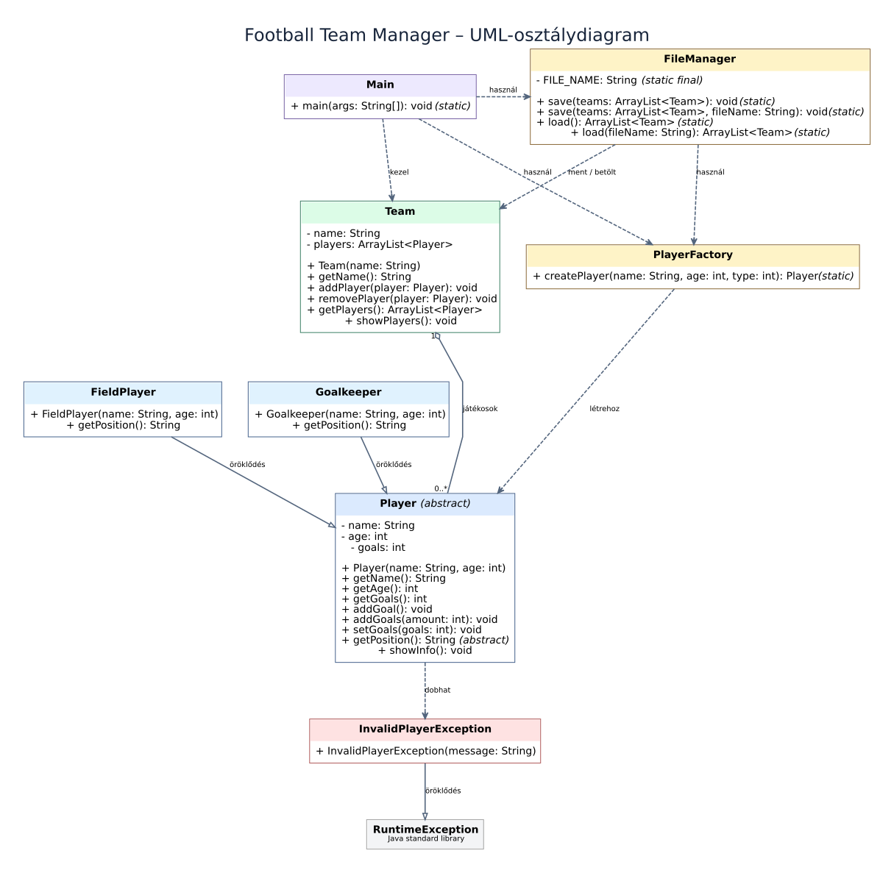

# Football Team Manager

## Projekt bemutatása

A Football Team Manager egy Java nyelven készített, konzolos alkalmazás, amely focicsapatok és játékosok kezelésére szolgál.

A projekt a Programozás 2 tantárgy beadandó feladataként készült. Célja az objektumorientált programozás alapelveinek gyakorlati alkalmazása, valamint a fájlkezelés, kivételkezelés és automatikus tesztelés bemutatása.

## Funkciók

A program az alábbi funkciókat biztosítja:

1. Új focicsapat létrehozása.
2. Játékos hozzáadása egy kiválasztott csapathoz.
3. Csapatok listázása.
4. Játékosok adatainak megjelenítése.
5. Gólok rögzítése.
6. Játékosok rendezése gólszám alapján.
7. Játékos törlése.
8. Kilépés és az adatok automatikus mentése.

A program indításkor automatikusan betölti a korábban elmentett adatokat.

## Felhasznált technológiák

- Java 21
- Maven
- JUnit 5
- IntelliJ IDEA
- Git és GitHub

## Objektumorientált megoldások

### Absztrakció és öröklődés

A `Player` egy absztrakt osztály, amely a játékosok közös tulajdonságait és metódusait tartalmazza.

Két leszármazott osztálya:

- `FieldPlayer` – mezőnyjátékos
- `Goalkeeper` – kapus

Mindkét osztály megvalósítja a `getPosition()` metódust.

### Egységbezárás

A játékosok adatai privát mezőkben találhatók. Az adatok elérését és módosítását publikus metódusok biztosítják.

### Polimorfizmus

A `Team` osztály `ArrayList<Player>` gyűjteményben tárolja a játékosokat, így a mezőnyjátékosok és kapusok egységesen kezelhetők.

### Factory tervezési minta

A `PlayerFactory` osztály felelős a játékosobjektumok létrehozásáért.

A `createPlayer()` metódus a megadott játékostípus alapján hozza létre a megfelelő objektumot.

Ezáltal a játékosok létrehozásának logikája egy helyen található.

### Kivételkezelés

A program saját `InvalidPlayerException` kivételosztályt használ az érvénytelen játékosadatok és játékostípusok kezelésére.

### Gyűjtemények és rendezés

A csapatok és játékosok tárolása `ArrayList` gyűjteményekkel történik.

A játékosok gólszám szerinti rendezését a `sort()` metódus és egy lambda-kifejezés valósítja meg.

## Adatok mentése és betöltése

Az adatok mentését és betöltését a `FileManager` osztály végzi.

A program szöveges fájlban (`teams.txt`) tárolja a csapatok és játékosok adatait.

A fájlműveletek `try-with-resources` szerkezetet használnak, amely gondoskodik az erőforrások lezárásáról.

## Program indítása

A program futtatásához Java 21 és Maven szükséges.

1. A projekt megnyitása IntelliJ IDEA-ban.
2. A Maven-függőségek betöltése.
3. A `src/main/java/footballmanager/Main.java` fájl megnyitása.
4. A `main()` metódus futtatása.

A konzolban megjelenő menüből választhatók ki a funkciók.

## Automatikus tesztelés

A projekt JUnit 5 egységteszteket tartalmaz.

A tesztosztályok:

- `PlayerTest` – játékosok létrehozása, gólok és hibás adatok kezelése, Factory működése.
- `TeamTest` – csapat létrehozása, játékosok hozzáadása és törlése.
- `FileManagerTest` – adatok mentése és visszatöltése.

A tesztek Maven segítségével futtathatók:

```bash
mvn test
```

A fájlkezelési teszt ideiglenes tesztfájlt használ, így nem módosítja a felhasználó mentett adatait.

## UML-osztálydiagram

A projekt osztályainak felépítését és kapcsolatait az alábbi UML-diagram szemlélteti:



## Projekt felépítése

```text
football-team-manager/
├── docs/
│   └── football-team-manager-uml.svg
├── src/
│   ├── main/java/footballmanager/
│   │   ├── Main.java
│   │   ├── Player.java
│   │   ├── FieldPlayer.java
│   │   ├── Goalkeeper.java
│   │   ├── Team.java
│   │   ├── PlayerFactory.java
│   │   ├── FileManager.java
│   │   └── InvalidPlayerException.java
│   └── test/java/footballmanager/
│       ├── PlayerTest.java
│       ├── TeamTest.java
│       └── FileManagerTest.java
├── pom.xml
├── README.md
└── LICENSE
```

## Továbbfejlesztési lehetőségek

A program később bővíthető további funkciókkal, például mérkőzések kezelésével, játékosstatisztikákkal, átigazolásokkal vagy grafikus felhasználói felülettel.

## Licenc

A projekt licencfeltételeit a `LICENSE` fájl tartalmazza.
